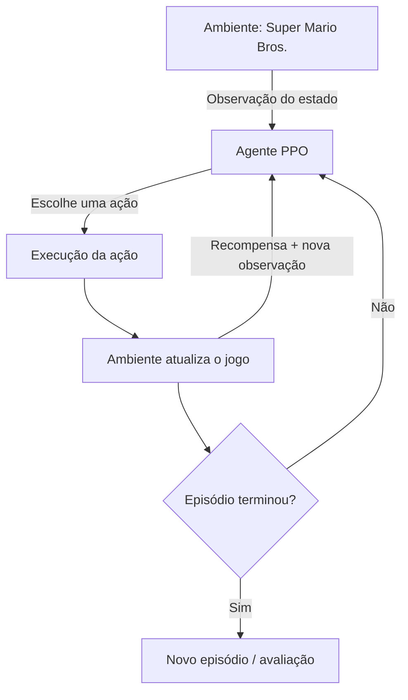
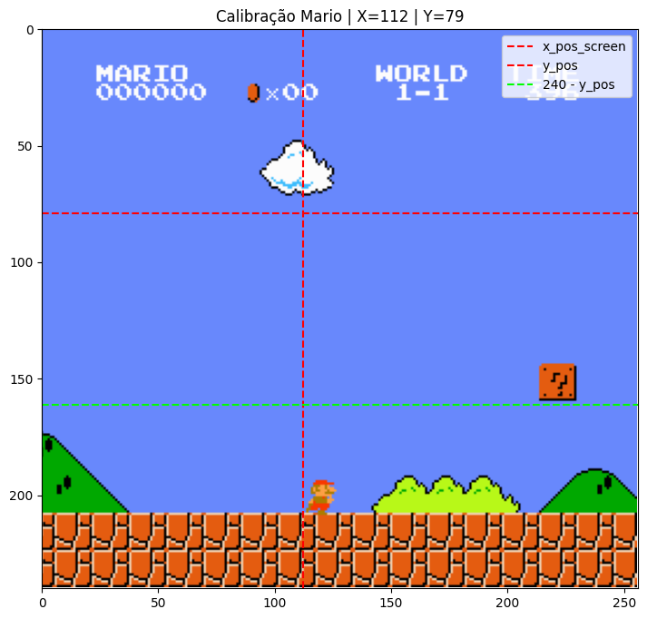
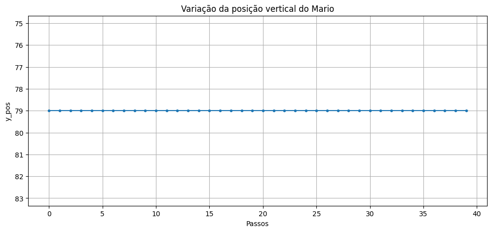
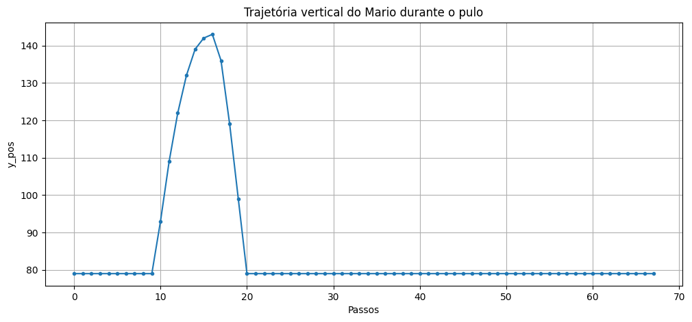
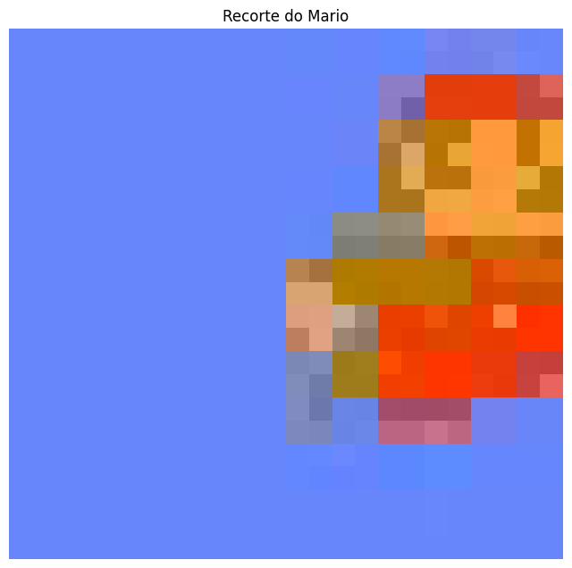
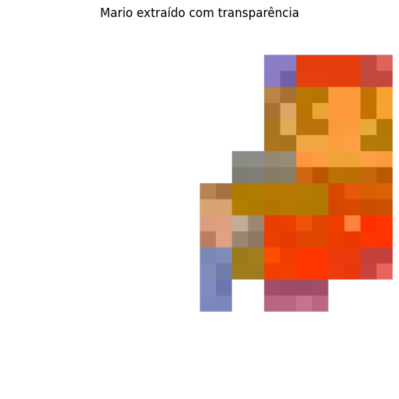
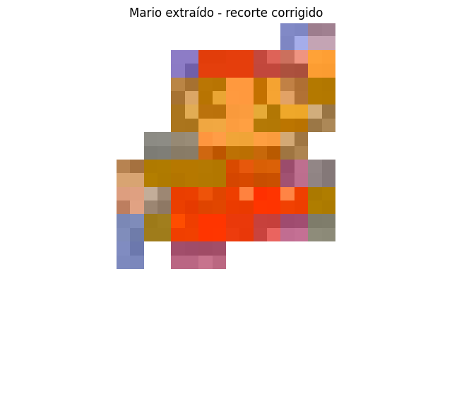

<div align="center">

# 🍄 Super Mario — Reinforcement Learning

**Um agente de Inteligência Artificial aprendendo a jogar Super Mario Bros. por tentativa e erro.**

[](https://www.python.org/)
[](https://stable-baselines3.readthedocs.io/)
[](https://github.com/Kautenja/gym-super-mario-bros)

</div>

---

## 📌 Sobre o projeto

Este projeto foi desenvolvido como atividade acadêmica da disciplina de **Inteligência Artificial**. A proposta é treinar um agente para jogar o primeiro estágio de *Super Mario Bros. (World 1-1)* utilizando **Aprendizado por Reforço (Reinforcement Learning)**.

Em vez de receber uma sequência fixa de comandos, o agente interage com o ambiente, observa o estado do jogo, escolhe ações e recebe recompensas. Ao longo do treinamento, o algoritmo atualiza sua política para tentar obter resultados melhores.

O treinamento utiliza o algoritmo **Proximal Policy Optimization (PPO)**, da biblioteca Stable-Baselines3, com uma política baseada em rede convolucional (`CnnPolicy`) para processar as observações visuais do jogo.

## 🎯 Objetivos

- Construir um agente capaz de aprender a jogar por interação com o ambiente.
- Aplicar conceitos de Aprendizado por Reforço na prática.
- Treinar e salvar checkpoints do modelo durante a execução.
- Avaliar o comportamento do agente em diferentes tentativas.
- Registrar trajetórias e visualizar diferentes execuções simultaneamente.
- Comparar uma execução que conclui a fase com tentativas anteriores.

## 🧠 Como funciona

O ciclo básico de Aprendizado por Reforço pode ser resumido assim:



**Elementos principais:**

- **Agente:** modelo que aprende a escolher ações.
- **Ambiente:** versão `SuperMarioBros-1-1-v0` disponibilizada por `gym-super-mario-bros`.
- **Observação:** informação visual recebida pelo agente após cada interação.
- **Ação:** comando selecionado dentro do conjunto `RIGHT_ONLY`.
- **Recompensa:** retorno numérico fornecido pelo ambiente.
- **Política:** estratégia aprendida pelo agente para selecionar ações.

## ⚙️ Tecnologias utilizadas

| Tecnologia | Utilização |
|---|---|
| Python | Linguagem principal |
| Gym / gym-super-mario-bros | Ambiente de jogo |
| nes-py | Emulação e integração com o jogo |
| Stable-Baselines3 | Implementação do PPO |
| PyTorch | Redes neurais utilizadas pelo modelo |
| OpenCV | Captura e processamento de frames |
| NumPy | Manipulação de dados |
| Pillow | Processamento de sprites e transparência |
| ImageIO / FFmpeg | Composição e exportação de vídeo |
| tqdm | Barra de progresso do treinamento |

## 🏋️ Configuração do treinamento

A configuração registrada no notebook é:

| Parâmetro | Valor |
|---|---:|
| Algoritmo | PPO |
| Política | `CnnPolicy` |
| Ambiente | `SuperMarioBros-1-1-v0` |
| Ambientes paralelos | 16 |
| `gamma` | 0.99 |
| `n_steps` | 1024 |
| `batch_size` | 64 |
| `learning_rate` | 0.0003 |
| `vf_coef` | 0.5 |
| `ent_coef` | 0.01 |
| Total planejado | 10.000.000 de timesteps |

O treinamento utiliza `SubprocVecEnv` para executar múltiplas instâncias do ambiente em paralelo. Um callback exibe o progresso e outro salva checkpoints periodicamente.

> **Observação:** os valores acima representam a configuração definida no notebook. O resultado final do treinamento completo ainda deve ser preenchido após a execução dos 10 milhões de timesteps.

## 📊 Visualizações e experimentos

As imagens abaixo documentam etapas do desenvolvimento: inspeção do ambiente, análise da posição vertical durante movimentos, e extração/preparação do sprite do Mario para a composição visual.

### 1. Ambiente e calibração das coordenadas

A imagem mostra o estado do jogo utilizado para conferir a posição do personagem e relacionar coordenadas do ambiente com coordenadas da tela.



### 2. Análise da posição vertical

Os gráficos foram utilizados para observar o comportamento vertical do Mario ao longo dos passos. Um deles registra uma sequência praticamente estável; o outro evidencia a variação de altura durante um pulo.

<div align="center">
  
  
</div>

### 3. Extração e preparação do sprite

Para criar a visualização das trajetórias, o Mario foi recortado de um frame e preparado com transparência. Esse sprite é utilizado para representar as tentativas anteriores como “fantasmas” sobre o vídeo da execução principal.

<div align="center">
  
  
  
</div>

### 4. Comparação de trajetórias

Uma das visualizações do projeto combina:

- **Mario principal:** execução selecionada que concluiu a fase.
- **Marios fantasmas:** posições de tentativas anteriores, desenhadas com transparência.
- **Trajetórias:** registros de posição do personagem ao longo dos passos.

A composição permite observar diferenças de percurso e pontos em que o agente se comportou de maneira distinta entre as execuções.

<!--
Quando adicionar o vídeo final ao repositório, descomente e ajuste o caminho:
<p align="center">
  <video src="assets/mario_com_fantasmas.mp4" controls width="720"></video>
</p>
-->

## 📁 Estrutura sugerida do repositório

```text
super-mario-reinforcement-learning/
├── README.md
├── Super Mario Reinforcement Learning.ipynb
├── OpenAIWrappers.py
├── assets/
│   ├── ambiente_mario_calibracao.png
│   ├── grafico_posicao_vertical_estavel.png
│   ├── grafico_trajetoria_pulo.png
│   ├── recorte_sprite_mario.png
│   ├── sprite_mario_transparente.png
│   └── sprite_mario_recorte_final.png
├── videos/
│   └── mario_com_fantasmas.mp4
└── modelos/
    └── (checkpoints do treinamento — opcional)
```

Os diretórios `videos/` e `modelos/` são ilustrativos: adicione-os apenas se desejar versionar esses arquivos. Modelos treinados e vídeos podem ser grandes; considere usar Git LFS ou disponibilizá-los em Releases/armazenamento externo.

## 🚀 Como executar

### 1. Clonar o repositório

```bash
git clone https://github.com/SEU-USUARIO/SEU-REPOSITORIO.git
cd SEU-REPOSITORIO
```

### 2. Preparar o ambiente

O projeto original foi desenvolvido em um ambiente legado com Python 3.7.16. As bibliotecas de RL e emulação possuem dependências sensíveis a versões; por isso, utilize as versões compatíveis documentadas no seu ambiente de desenvolvimento, em vez de instalar indiscriminadamente as versões mais recentes.

Bibliotecas utilizadas:

```bash
pip install gym==0.25.1
pip install stable-baselines3==2.0.0
pip install gym-super-mario-bros
pip install opencv-python numpy pillow imageio tqdm
```

> **Atenção:** este bloco é uma referência inicial, não um arquivo de instalação reproduzível garantido. Confira a compatibilidade entre Python, Gym, Stable-Baselines3, PyTorch e `nes-py` antes de recriar o ambiente. Recomenda-se registrar as versões efetivamente funcionais em `requirements.txt`.

### 3. Organizar os arquivos

Mantenha o notebook e `OpenAIWrappers.py` na mesma pasta, ou ajuste os imports conforme a estrutura escolhida. Atualize os caminhos absolutos de checkpoints, vídeos e arquivos JSON para caminhos relativos ao projeto.

### 4. Executar o notebook

Abra `Super Mario Reinforcement Learning.ipynb` no Jupyter Notebook ou VS Code e execute as células na ordem:

1. Teste do ambiente.
2. Definição do callback de progresso.
3. Criação dos ambientes paralelos e treinamento PPO.
4. Carregamento do checkpoint e avaliação do agente.
5. Registro das tentativas e composição das trajetórias.

## 📈 Próximos passos

- [ ] Concluir o treinamento planejado de 10 milhões de timesteps.
- [ ] Registrar o tempo total e os resultados do treinamento.
- [ ] Avaliar o modelo final em múltiplas execuções.
- [ ] Aumentar a coleção de trajetórias para permitir comparar até 100 tentativas.
- [ ] Gerar gráficos de desempenho do treinamento (recompensa, comprimento dos episódios e taxa de conclusão), quando os dados estiverem disponíveis.
- [ ] Melhorar a comparação visual entre a execução principal e as trajetórias anteriores.

## 👨‍💻 Autoria

Projeto acadêmico desenvolvido para a disciplina de **Inteligência Artificial**.

**Equipe:** Amanda da Silva, Geraldez de Medeiros e William Pereira de Almeida

---

<div align="center">

Feito com Python, aprendizado por reforço e muitas tentativas do Mario. 🍄

</div>
